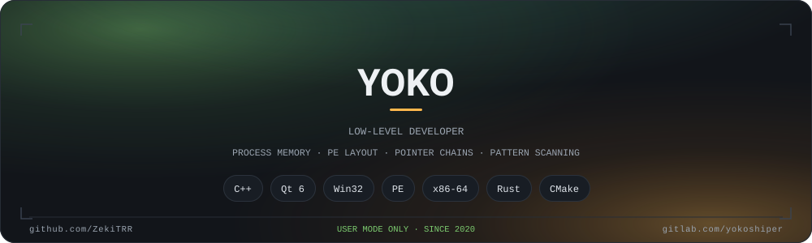

**EN** · [Русский](README.ru.md)

I write software for Windows in C++ and Qt, and I stay in user mode on purpose: process memory,
PE layout, pointer chains, pattern scanning. Everything here started as a tool I needed for myself.

## Stack

**Daily** — `C++` `Qt 6` `Win32` `x86-64` `CMake`
**Learning** — `Rust` (FFI and memory tooling) `Go` `Python` `C#`
**Tools** — IDA · Ghidra · x64dbg · Cheat Engine

## Elsewhere

GitLab — [gitlab.com/yokoshiper](https://gitlab.com/yokoshiper)

