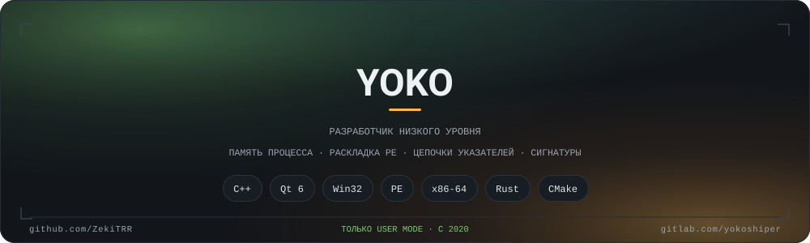

[English](README.md) · **Русский**

Пишу софт под Windows на C++ и Qt и сознательно остаюсь в user mode: память процесса, раскладка PE,
цепочки указателей, поиск по сигнатурам. Каждый проект здесь вырос из инструмента, который был нужен мне самому.

## Стек

**Каждый день** — `C++` `Qt 6` `Win32` `x86-64` `CMake`
**Изучаю** — `Rust` (FFI и инструменты для памяти) `Go` `Python` `C#`
**Инструменты** — IDA · Ghidra · x64dbg · Cheat Engine

## Ещё где

GitLab — [gitlab.com/yokoshiper](https://gitlab.com/yokoshiper)

